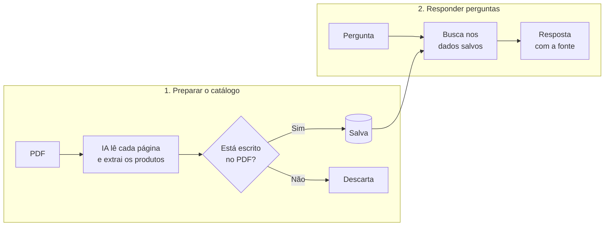

# IntelliDoc

**Assistente com IA que lê catálogos em PDF, responde perguntas com a fonte e não inventa informações.**


<!-- Adicione aqui uma captura de tela ou um GIF da interface, por exemplo:
 -->

---

## O problema

Catálogos de produtos costumam ser PDFs longos. Encontrar um produto, comparar preços ou listar uma categoria inteira toma tempo. E um chatbot comum tem um risco sério: **ele pode inventar um preço ou um produto que não existe** (o que em IA se chama *alucinação*).

## A solução

O IntelliDoc transforma o PDF em uma base que pode ser consultada em linguagem natural:

- Você envia um catálogo em PDF e faz perguntas como *"Quais produtos custam menos de R$ 100,00?"* ou *"Quais são os produtos masculinos?"*.
- Ele responde com o **nome, preço, página e arquivo de origem** de cada produto, mostrados em cartões com a foto original do catálogo.
- Toda informação extraída pela IA é **conferida com o texto real da página** antes de ser usada.

---

## Destaques técnicos

### 1. Validação com a fonte
**Nada entra sem prova no texto da página.** A IA lê o PDF e extrai os produtos, mas cada informação (nome, preço, código) é conferida com o que está escrito no próprio PDF. O que não aparece lá é descartado, e as respostas sempre mostram o arquivo e a página de onde a informação veio.

### 2. Busca híbrida: IA para entender, código para filtrar
O LLM apenas **interpreta a pergunta** e a transforma em filtros (público, faixa de preço, ordenação). A filtragem em si é feita **em código, sobre todos os produtos armazenados**. Assim, uma pergunta como "quais são os produtos masculinos?" traz a lista completa, e não só os trechos mais parecidos que uma busca semântica retornaria. Perguntas gerais sobre o documento seguem para o RAG tradicional.

### 3. Saída estruturada e validada
As respostas dos modelos usam esquemas **Pydantic** em modo estrito (`json_schema`), com `temperature=0` e novas tentativas automáticas. O formato dos dados é sempre previsível.

### 4. Verificação por dois modelos nas fotos
Um modelo localiza a foto de cada produto na página e refina a posição com zoom. **Um segundo modelo confirma** se o recorte mostra mesmo aquele produto. Sem confirmação, o cartão exibe "Imagem não localizada" em vez de uma foto errada. A remoção de fundo roda **localmente** (modelo ONNX via `rembg`), sem custo de API.

### 5. Escolha de modelos por teste
Cada tarefa usa o modelo adequado ao custo e à precisão: `gpt-4.1` para visão, `gpt-4.1-mini` para verificação e `gpt-4o-mini` para texto. O `gpt-4o-mini` foi testado para localizar fotos e **não acertou a posição dos produtos**, por isso não é usado nessa etapa.

### 6. Processamento eficiente
- Páginas processadas **em paralelo**.
- **Hash SHA-256** do arquivo: um PDF já processado e sem mudanças não é processado de novo (sem gasto extra de API).
- Uma nova versão do arquivo **substitui a anterior** sem duplicar produtos, trechos ou imagens.

---

## Como funciona

O projeto funciona em duas fases:



1. **Preparar:** a IA lê o PDF e extrai os produtos. Tudo é conferido com o texto do PDF, e o que não está escrito nele é descartado.
2. **Responder:** a pergunta é respondida só com os dados que passaram na conferência, sempre mostrando o arquivo e a página de origem.

| Etapa | Arquivo | O que faz |
|-------|---------|-----------|
| RAG de texto | `criar_db.py` | Extrai o texto do PDF, divide em trechos (*chunks*), gera *embeddings* (`text-embedding-3-small`), guarda no ChromaDB e responde com `gpt-4o-mini`, sempre citando arquivo e página. |
| Extração de produtos | `catalogo/extracao.py` | Modelo de visão estrutura os produtos de cada página; cada campo é validado contra o texto real. |
| Fotos | `catalogo/imagens.py`, `catalogo/fotos.py` | Localiza, confirma e isola a foto de cada produto. |
| Busca | `catalogo/busca.py` | Interpreta a pergunta e filtra todos os produtos em código. |
| Armazenamento | `catalogo/repositorio.py` | Produtos em SQLite, com chave estrangeira, índices e migração automática. |
| Interface | `interface.py`, `catalogo/apresentacao.py` | Upload, progresso, chat e cartões de produtos (Streamlit). |
| Versão de terminal | `app.py` | Primeira versão do projeto, com menu no terminal. |

## Stack

- **Linguagem:** Python
- **IA:** OpenAI API (GPT-4.1, GPT-4.1-mini, GPT-4o-mini, text-embedding-3-small), LangChain
- **RAG:** ChromaDB (banco vetorial), embeddings, busca semântica
- **Dados:** SQLite, Pydantic
- **PDF e imagem:** PyMuPDF, pypdf, OpenCV, rembg (ONNX)
- **Interface:** Streamlit

---

## Como executar

**1. Instale as dependências**

```bash
pip install -r requirements.txt
```

**2. Adicione sua chave da OpenAI** em um arquivo `.env` na pasta do projeto:

```
OPENAI_API_KEY=sua-chave-aqui
```

**3. Abra a interface**

```bash
streamlit run interface.py
```

Prefere o terminal? Use `python app.py`.

> Recomendado: crie um ambiente virtual antes (`python -m venv .venv`). Na primeira execução, um modelo local de cerca de 180 MB é baixado automaticamente.

<details>
<summary><b>Processar catálogos pelo terminal</b></summary>

```bash
python -m catalogo.processamento --todos            # todos os PDFs de data/documents
python -m catalogo.processamento "data/documents/arquivo.pdf"
python -m catalogo.processamento --todos --forcar   # reprocessa mesmo sem mudanças
python -m catalogo.fotos --forcar                   # refaz só as fotos, sem extrair de novo
```
</details>

<details>
<summary><b>Configuração opcional (.env)</b></summary>

| Variável | Padrão | Uso |
|----------|--------|-----|
| `INTELLIDOC_MODELO_VISAO` | `gpt-4.1` | Identificação dos produtos e localização das fotos |
| `INTELLIDOC_MODELO_VERIFICACAO` | `gpt-4.1-mini` | Confirmação de cada foto |
| `INTELLIDOC_MODELO_TEXTO` | `gpt-4o-mini` | Interpretação das perguntas |
| `INTELLIDOC_MODELO_RECORTE` | `isnet-general-use` | Modelo local que separa o produto do fundo |
| `INTELLIDOC_TRABALHADORES` | `6` | Páginas processadas em paralelo |
</details>

---

## Transparência sobre o uso de IA no desenvolvimento

- **Desenvolvido por mim:** somente a parte de terminal, que foi a base do projeto. Isso inclui a versão de terminal (`app.py`) e o pipeline de RAG usado por ela (`criar_db.py`): validação do arquivo, extração do texto do PDF, divisão em trechos, geração de embeddings, armazenamento no ChromaDB, busca dos trechos relevantes e geração da resposta com fonte.
- **Desenvolvido com auxílio de IA:** todo o restante, ou seja:
  - a parte visual: interface em Streamlit, cartões de produtos e identidade visual (`interface.py`, `catalogo/apresentacao.py`);
  - o código que integra a base de terminal a essa parte visual;
  - a extração e a validação dos produtos com o modelo de visão (`catalogo/extracao.py`, `catalogo/busca.py`);
  - a parte de imagens: localizar a foto de cada produto na página do catálogo, comparar o recorte com o produto para confirmar que é a imagem certa e separar o produto do fundo (`catalogo/imagens.py`, `catalogo/fotos.py`).

## Limitações e próximos passos

- Os campos extraídos foram pensados para catálogos de cosméticos e perfumaria.
- Depende da API da OpenAI, que tem custo por uso, principalmente no modelo de visão.
- Próximos passos: testes automatizados, avaliação da qualidade das respostas com um conjunto de perguntas de referência e uma demonstração online.

---

## Autor

**Thiago Santana**, desenvolvedor backend (Java e Python) com foco em IA generativa.

[LinkedIn](https://www.linkedin.com/in/thiago-santana-araujo/) · [GitHub](https://github.com/ThiagoSantana083)
